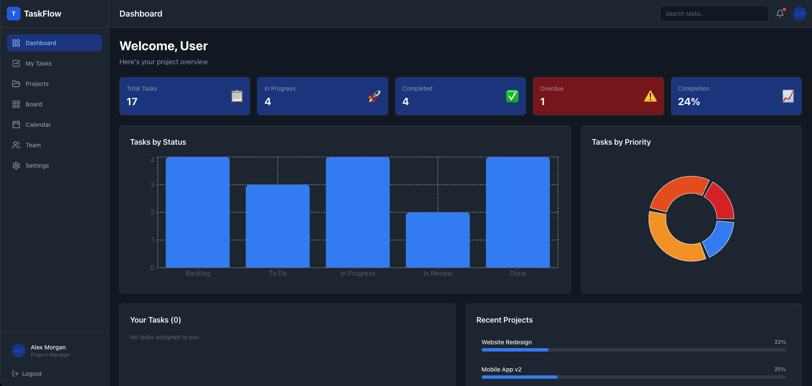
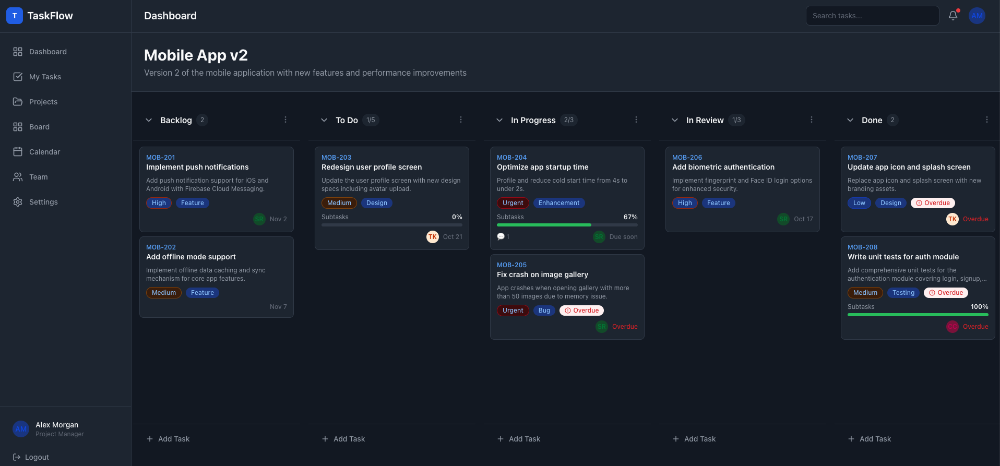

# TaskFlow - Modern Project Management Application

A complete, production-quality Kanban board project management web application built with React, featuring drag-and-drop interactions, task management, team collaboration, and comprehensive project tracking.




## Features

### Core Functionality
- **Kanban Board** - Organize tasks across customizable columns with drag-and-drop support
- **Project Management** - Create, edit, and manage multiple projects
- **Task Management** - Create, edit, assign, and track tasks with full lifecycle management
- **Drag & Drop** - Smooth, accessible drag-and-drop powered by @dnd-kit
- **Priority Levels** - Urgent, High, Medium, Low task priorities with visual indicators
- **Labels & Tags** - Organize tasks with customizable labels
- **Subtasks** - Break down tasks into smaller subtasks with progress tracking
- **Comments** - Add comments and collaborate on tasks
- **Activity Timeline** - Track task changes and important events

### Dashboard & Analytics
- **Overview Dashboard** - At-a-glance project and task statistics
- **Charts & Visualizations** - Task distribution by status and priority
- **Task Analytics** - Completion rates, overdue tracking, and progress metrics
- **Project Progress** - Visual progress indicators for each project

### Additional Pages
- **My Tasks** - Personal task list with filtering (Today, Upcoming, Overdue, Completed)
- **Calendar View** - Visual task calendar with due date tracking
- **Team Management** - Team member profiles and task assignments
- **Projects** - Manage all projects with quick access and statistics

### User Experience
- **Responsive Design** - Works seamlessly on desktop, tablet, and mobile
- **Dark Mode** - Complete light/dark theme support
- **Notifications** - In-app notification center with unread tracking
- **Search & Filter** - Advanced task search and multi-filter support
- **Confirmation Dialogs** - Safe deletion with confirmation prompts
- **Accessibility** - Semantic HTML, keyboard navigation, focus management

### Data Management
- **Local Storage Persistence** - All data persists in browser LocalStorage
- **Demo Data** - Pre-loaded with realistic example data
- **Data Reset** - Option to reset to demo data from settings

## Technology Stack

- **React 19.3** - Modern UI framework with hooks
- **Vite** - Lightning-fast build tool and dev server
- **Tailwind CSS v4** - Utility-first CSS with modern features
- **@dnd-kit** - Accessible drag-and-drop library
- **React Router** - Client-side routing
- **React Hook Form** - Efficient form management
- **Zod** - Runtime schema validation
- **Recharts** - Data visualization charts
- **Lucide React** - Beautiful icon library
- **date-fns** - Date manipulation utilities

## Project Structure

```
src/
├── components/
│   ├── layout/
│   │   └── AppLayout.jsx          # Main layout with sidebar and header
│   ├── board/
│   │   └── KanbanBoard.jsx        # Kanban board with drag-and-drop
│   ├── tasks/
│   │   ├── TaskModal.jsx          # Create/edit task modal
│   │   └── TaskCard.jsx           # Task card and details panel
│   ├── common/
│   │   └── index.jsx              # Reusable UI components
│   ├── projects/
│   ├── dashboard/
│   ├── calendar/
│   ├── team/
│   └── notifications/
├── context/
│   └── AppContext.jsx             # Global app state management
├── hooks/
│   └── index.js                   # Custom hooks (useProjects, useTasks, etc.)
├── pages/
│   ├── DashboardPage.jsx
│   ├── BoardPage.jsx
│   ├── MyTasksPage.jsx
│   ├── ProjectsPage.jsx
│   ├── CalendarPage.jsx
│   ├── TeamPage.jsx
│   └── SettingsPage.jsx
├── services/
│   └── storageService.js          # LocalStorage persistence
├── utils/
│   ├── idUtils.js                 # ID generation
│   ├── dateUtils.js               # Date formatting and utilities
│   ├── taskUtils.js               # Task constants and helpers
│   └── validation.js              # Form validation schemas
├── data/
│   └── initialData.js             # Demo data and seeding
├── styles/
│   └── index.css                  # Tailwind CSS configuration
├── App.jsx                        # Main app component
└── main.jsx                       # Entry point
```

## Installation

### Prerequisites
- Node.js 18+ and npm

### Setup

```bash
# Clone or navigate to the project directory
cd taskflow

# Install dependencies
npm install

# Start development server
npm run dev

# Open browser to http://localhost:5173
```

### Development Commands

```bash
# Start dev server with hot reload
npm run dev

# Build for production
npm run build

# Preview production build
npm run preview
```

## Data Model

### Projects
```javascript
{
  id: string,
  name: string,
  description: string,
  color: string,
  memberIds: string[],
  dueDate: string (ISO),
  createdAt: string (ISO),
  updatedAt: string (ISO)
}
```

### Columns
```javascript
{
  id: string,
  projectId: string,
  title: string,
  position: number,
  taskIds: string[],
  wipLimit: number | null,
  isCollapsed: boolean
}
```

### Tasks
```javascript
{
  id: string,
  projectId: string,
  columnId: string,
  taskId: string (e.g., "TASK-101"),
  title: string,
  description: string,
  priority: "low" | "medium" | "high" | "urgent",
  assigneeId: string | "",
  collaboratorIds: string[],
  labels: string[],
  startDate: string (ISO),
  dueDate: string (ISO),
  estimatedEffort: string,
  subtasks: Subtask[],
  comments: Comment[],
  attachments: Attachment[],
  activity: Activity[],
  createdAt: string (ISO),
  updatedAt: string (ISO),
  archivedAt: string (ISO) | null
}
```

### Users
```javascript
{
  id: string,
  name: string,
  email: string,
  avatar: string | null,
  role: string
}
```

## State Management

TaskFlow uses React Context API with useReducer for centralized state management. All data is automatically persisted to LocalStorage on every state change.

### useApp Hook
Access global app state and dispatch actions:
```javascript
const { state, dispatch, currentUser, getUser } = useApp();
```

### Custom Hooks
- `useProjects()` - Manage projects
- `useColumns(projectId)` - Manage columns
- `useTasks(columnId, projectId)` - Manage tasks
- `useTheme()` - Theme toggling
- `useNotifications()` - Notification management

## Key Features Walkthrough

### Creating a Project
1. Navigate to Projects page
2. Click "New Project"
3. Enter project details (name, description, color)
4. Confirm creation - default columns are auto-created

### Managing Tasks
1. Navigate to Board page (or select a project)
2. Click "Add Task" on any column
3. Fill in task details (title, priority, assignee, dates, labels)
4. Save to add task to the column

### Drag & Drop
- Click and hold a task card
- Drag to another column or reorder within the same column
- Drop to save the new position
- Works on desktop, tablet, and touch devices

### Task Details
- Click any task card to open the details panel
- View and edit all task information
- Manage subtasks
- Add and view comments
- Track activity history

### Filtering & Search
- Use search bar to find tasks by title, description, or ID
- Apply filters by status, priority, assignee, or due date
- Combine multiple filters
- Clear all filters with one click

## Local Storage

All application data is stored locally in your browser using LocalStorage under the key `taskflow_v1`. 

**Important Notes:**
- Data is **device-specific** and not synced to any server
- Data persists across browser sessions
- Clear browser data/cache to reset application
- Each browser/device maintains separate data
- No cloud backup or multi-user synchronization

## Keyboard Shortcuts

- `Escape` - Close modals and detail panels
- `Enter` - Submit forms (in most input contexts)
- `Tab` - Navigate through form fields

## Accessibility

- Semantic HTML structure
- ARIA labels for icon-only buttons
- Keyboard navigation throughout
- Focus management in modals
- High contrast color schemes
- Screen reader friendly

## Browser Support

- Chrome/Edge (latest)
- Firefox (latest)
- Safari (latest)
- Mobile browsers (iOS Safari, Chrome Android)

## Performance

- Lazy rendering with virtualization where needed
- Optimized re-renders with React hooks
- Efficient drag-and-drop with @dnd-kit
- Minimal dependencies
- ~150KB gzipped bundle size

## Contributing

This is a demo project built to showcase modern React patterns and best practices. Feel free to:
- Extend features
- Add tests
- Integrate with a backend API
- Deploy to production

## Future Enhancements

- Backend API integration
- Real-time collaboration
- File attachments
- Advanced reporting
- Custom workflows
- Automation rules
- Time tracking
- Budget management
- Team permissions and roles

## License

MIT License - Feel free to use for personal and commercial projects.

## Support

For issues, questions, or suggestions, refer to the application's Settings page for information about the current version and components used.

---

**Built with ❤️ using React, Vite, and Tailwind CSS**
